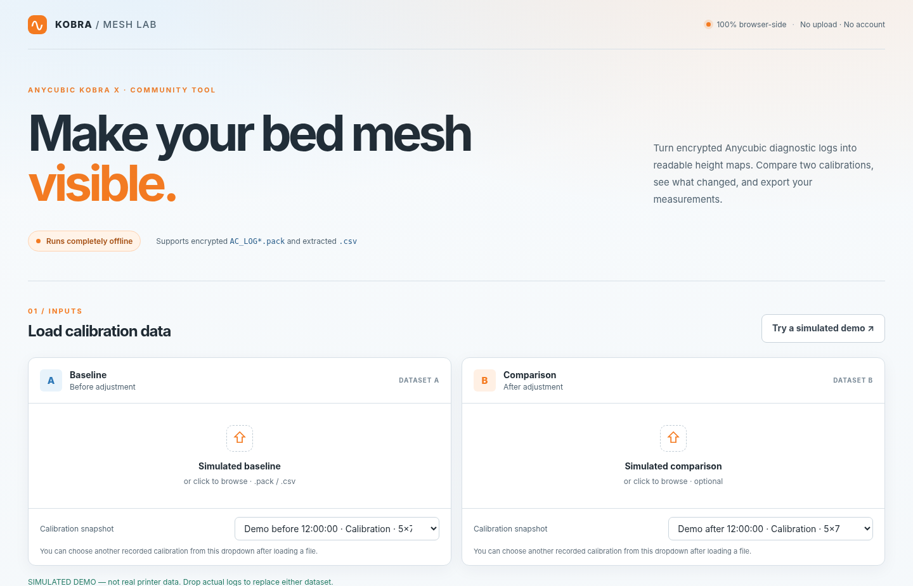
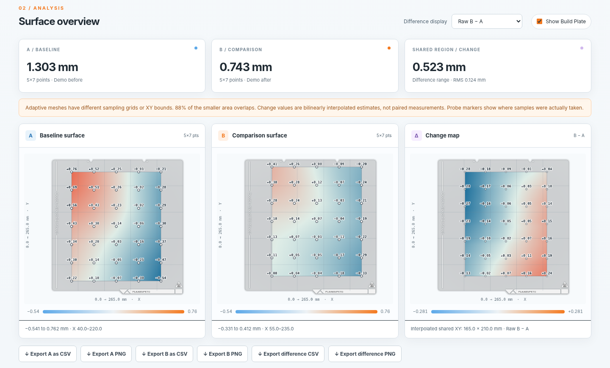
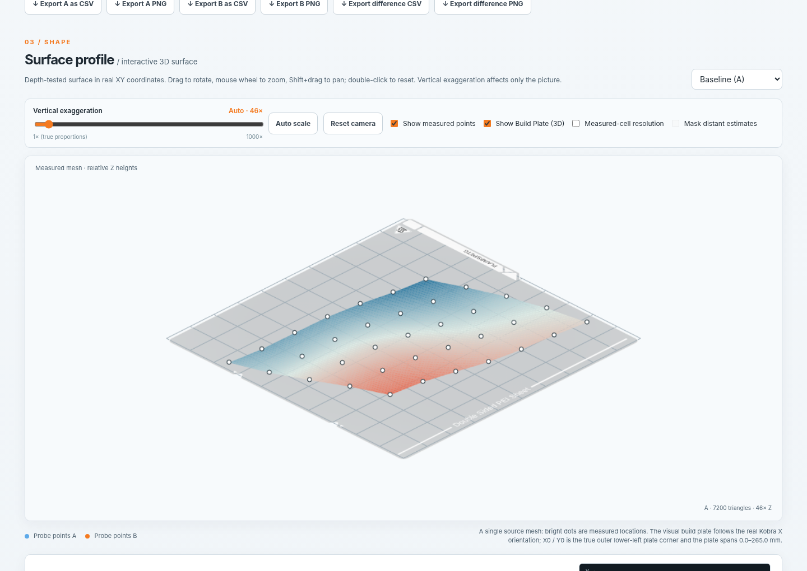
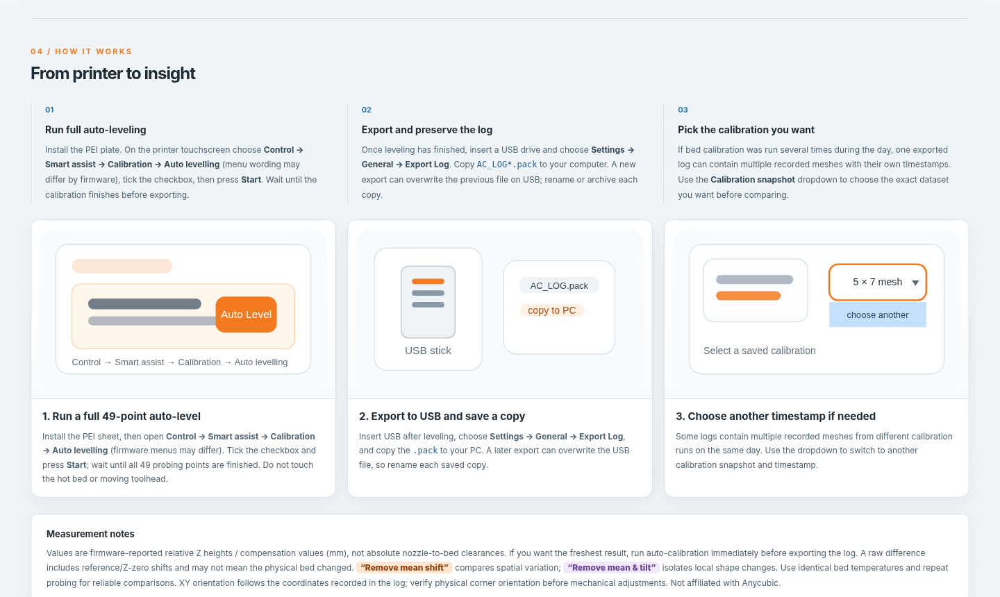

# Kobra Mesh Lab

A small, free browser tool I made to view and compare bed leveling data from the **Anycubic Kobra X**.

### [🌐 Open Kobra Mesh Lab](https://goodvind.github.io/kobra-mesh-lab/)

No installation or account is needed to use the website. You can also download `kobra-mesh-lab-v1.2.14-standalone.html` and open it in Chrome or Edge if you prefer to run it offline.

## What it does

- Reads exported Anycubic Kobra X `AC_LOG*.pack` files and supported mesh CSV files.
- Shows full-bed and adaptive bed leveling data as **2D heatmaps** and an **interactive 3D surface**.
- Lets you choose different saved calibration snapshots from the same log (when available).
- Compares two calibrations with a **Change map** (`B − A`).
- Exports the maps as PNG and the measurements as CSV.
- Runs locally in your browser — **the app does not upload your log files**.

## How to use it

### 1. Run auto leveling on your Kobra X

1. Make sure the PEI build plate is installed correctly.
2. On the printer touchscreen, open **Control → Smart assist → Calibration → Auto levelling**.
3. **Put a checkmark in the checkbox**, then press **Start**.
4. Let the printer complete the calibration. Keep clear of the moving toolhead and hot bed.

### 2. Export the diagnostic log

1. Insert a USB drive into the printer.
2. Open **Settings → General → Export Log**.
3. After the export, connect the USB drive to your computer and copy the `AC_LOG*.pack` file to a folder on your computer.

**Important:** a new log export can overwrite the previous file on the USB drive. Save or rename each copy on your computer if you want to compare results later.

A log may contain **several calibrations with timestamps**, especially if you performed calibration multiple times that day. You can choose which one to view inside the tool.

### 3. Open the website and load your file

Open **[Kobra Mesh Lab](https://goodvind.github.io/kobra-mesh-lab/)**. Drop a `.pack` file into **Baseline (A)** or click the area to browse. If there are multiple entries, use **Calibration snapshot** to select the one you want. You can also click **Try a simulated demo** to explore the interface without a log.

### 4. Compare two calibrations (optional)

Add another log in **Comparison (B)** — or choose another saved snapshot from your logs. The site will display three panels: **Baseline (A)**, **Comparison (B)**, and **Change map (B − A)**.

The **Difference display** menu offers three ways to view the change:

- **Raw B − A** — the direct difference between two measurements.
- **Remove mean shift** — removes an overall vertical offset to focus on differences across the bed.
- **Remove mean & tilt** — also removes a best-fit overall slope to highlight local shape changes.

### 5. Explore the 3D surface

Scroll to **Surface profile**. Select **Baseline (A)**, **Comparison (B)** or **Difference (Δ)**. Drag to rotate, use the mouse wheel to zoom, and double-click to reset the camera. The **Vertical exaggeration** slider makes small height variations easier to see; it does not change the measurements.

Use **Show Build Plate** in the 2D or 3D controls to display the Kobra X PEI plate for orientation.

### 6. Export your results

Use the buttons below the heatmaps to save **A PNG**, **B PNG**, **Difference PNG**, or the corresponding **CSV** measurements. The PNG maps are exported at **1120 × 960 px**. Exports are created locally by your browser.

## Quick visual guide

The website also has a **From printer to insight** section with the calibration and export steps:

## Privacy and limitations

The application processes selected files in your browser. It does not need a backend or database, and it has no built-in telemetry or file-upload feature. The Content Security Policy blocks application network connections. GitHub Pages may still log ordinary visits to the hosted website.

Measurements represent **firmware-reported relative Z heights / compensation values**, not absolute nozzle-to-bed gaps. Differences between separate probe grids may be interpolated. Before physically adjusting the printer, verify the plate orientation and repeat measurements under comparable conditions.

This is an unofficial community project and is not affiliated with Anycubic.

## Want to run it locally?

Download `kobra-mesh-lab-v1.2.14-standalone.html` and open it with Chrome or Edge. You don't need to install anything or run a server.

## Hosting with GitHub Pages

Upload the **contents** of this project folder to the **root** of a public GitHub repository, keeping `index.html`, the `.js`/`.css` files, `assets/`, `vendor/`, and `docs/screenshots/` in their original locations.

Then go to **Settings → Pages → Build and deployment**, set **Source** to **Deploy from a branch**, choose **main** and **/(root)**, and save. Once GitHub Pages is ready, click **Visit site** and put that URL into the two website links at the top of this README.

**Do not upload your actual `AC_LOG*.pack` files** to the public repository; they may contain other printer diagnostic information.

---

If you spot a bug or have a suggestion, feel free to open an issue. I'm still improving the tool.
